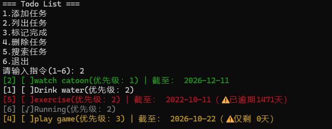

# Todo CLI - 极简命令行待办事项

一个使用现代 C++ (C++11/14/17) 编写的命令行待办事项管理工具。支持任务的增删改查、优先级排序、截止日期倒计时以及数据持久化存储。


##  功能特性

- **📌 核心管理**：轻松添加、删除、列出和标记完成任务。
- **⏱️ 时间追踪**：支持设置截止日期，自动计算剩余天数并高亮显示逾期警告。
- **🎨 终端美化**：利用 ANSI 转义序列，根据任务状态（逾期、紧急、完成）自动切换终端文字颜色。
- **🔍 模糊搜索**：快速按关键字检索任务标题，忽略大小写。
- **💾 数据持久化**：所有任务自动保存至本地 `todo.txt` 文件，重启程序不丢失。
- **🛡️ 安全防呆**：处理非法输入（如输入字母代替数字）防止程序崩溃。

## 运行截图



## 快速开始

### 环境要求
- Windows / Linux / macOS
- 支持 C++11 及以上的编译器（如 GCC, Clang, MSVC）

### 编译与运行
使用 `g++` 命令行编译：
```bash
g++ main.cpp Task.cpp TodoList.cpp -o TodoApp -std=c++17
./TodoApp
```
# 使用说明
程序启动后，会显示交互菜单，输入对应的数字即可执行操作：
```text
=== Todo List ===
1. 添加任务
2. 列出任务
3. 标记完成
4. 删除任务
5. 搜索任务
6. 退出
请输入指令 (1-6): 
```
- 添加任务时，日期请严格遵循 `YYYY-MM-DD` , 如果直接回车，或不按要求格式输入，则默认无截至日期
- 任务在列表中会自动根据优先级排序

# 技术栈与知识点
本项目在开发过程中实践了以下的C++特性：
- 面向对象 (OOP)：类的封装与接口设计。
- STL 容器与算法：std::vector、std::sort、Lambda 表达式。
- 时间库：<chrono> 用于计算时间点与剩余天数。
- 文件流：<fstream> 实现数据的序列化与反序列化。
- I/O 控制：<iomanip> 与 Windows API 实现 UTF-8 与彩色终端输出。

# 开源协议
本项目基于 MIT License 协议开源。
